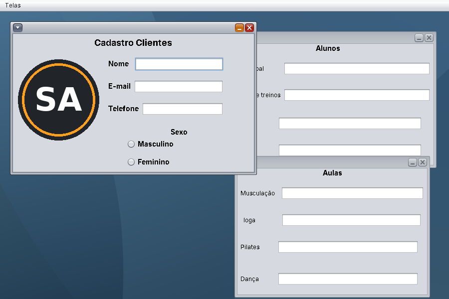
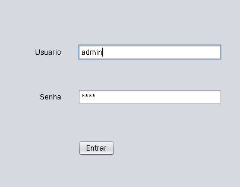
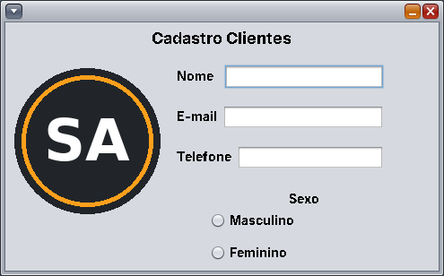
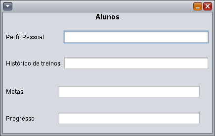
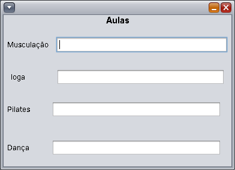

# Sistema de Academia

Protótipo desktop em Java Swing para a gestão de uma academia, com login, cadastro de clientes, área do aluno e grade de aulas.

[](https://github.com/lbraz55/Sistema-de-Academia/actions/workflows/build.yml)


[](LICENSE)



---

## Sumário

- [Sobre o projeto](#sobre-o-projeto)
- [Funcionalidades implementadas](#funcionalidades-implementadas)
- [Stack e dependências](#stack-e-dependências)
- [Arquitetura e organização](#arquitetura-e-organização)
- [Como executar](#como-executar)
- [Decisões técnicas e trade-offs](#decisões-técnicas-e-trade-offs)
- [O que ficou de fora e próximos passos](#o-que-ficou-de-fora-e-próximos-passos)
- [Aprendizados](#aprendizados)
- [Licença e autoria](#licença-e-autoria)

---

## Sobre o projeto

Este projeto nasceu em 2024 como trabalho em grupo da faculdade. A proposta era desenhar a interface de um sistema para academia: uma aplicação de desktop em que a recepção cadastra clientes, o aluno acompanha metas e progresso e a academia divulga as modalidades de aula.

O foco do trabalho era **a camada visual**. As telas foram montadas no GUI Builder do NetBeans com a ideia de que, numa etapa posterior, ganhariam comportamento de verdade (salvar cadastros, consultar alunos etc.). Essa etapa não chegou a acontecer, então o que existe hoje é um **protótipo navegável**: as telas abrem, os campos aceitam digitação, mas nada é gravado.

### Sobre a reorganização

Na época, o código acabou sendo publicado de um jeito pouco ortodoxo: todas as classes foram coladas, em sequência, dentro deste README. Em 2026 o repositório foi reorganizado para virar um projeto Java de verdade. Para manter a transparência, este é o registro do que mudou:

| O que foi feito | Por quê |
|---|---|
| As quatro classes foram extraídas do README para arquivos `.java` próprios. | Era o problema principal: o código não podia ser compilado onde estava. |
| As quebras de linha que a colagem tinha apagado foram restauradas. | Sem elas, a assinatura do `main` e vários `setText(...)` tinham virado comentário (ficavam depois de um `//` ou dentro de um `/** ... */`). |
| O final de `CadastroCliente` foi **reconstruído**: o layout vertical e a declaração de variáveis. | O texto original terminava no meio de uma linha. O trecho novo espelha o layout horizontal, que chegou completo, e está marcado com um comentário no código. |
| A classe `TelaPrincipal` foi **criada**. | O login já referenciava uma `TelaPrincipal`, mas ela nunca foi implementada. Sem ela, as três telas internas eram inalcançáveis. |
| O logo foi recriado (um "SA" simples). | A imagem original não estava no repositório e se perdeu. |
| `Telas` virou `telas`, `CadastroClient` virou `CadastroCliente` e o logo ganhou um nome sem espaço nem acento. | Convenção de nomes do Java, consistência com o resto do projeto em português e compatibilidade dentro do `.jar`. |
| Foram adicionados `pom.xml`, `.gitignore`, `LICENSE` e CI. | Tudo o que um projeto Java precisa para ser clonado e executado por outra pessoa. |

Fora isso, **a lógica original foi preservada**, inclusive as limitações listadas mais abaixo.

---

## Funcionalidades implementadas

O que funciona hoje:

- **Login** com usuário e senha fixos (`admin` / `1234`), mensagem de boas-vindas e redirecionamento para a tela principal.
- **Tela principal** com um menu **Telas** que abre cada tela interna. Reabrir uma tela que já está aberta só a traz para frente, sem duplicar.
- **Cadastro de Clientes**: campos de nome, e-mail e telefone, seleção de sexo e logo da academia.
- **Área do Aluno**: campos de perfil pessoal, histórico de treinos, metas e progresso.
- **Aulas**: campos para as modalidades musculação, ioga, pilates e dança.
- Tema **Nimbus**, quando disponível na JVM.

| Login | Cadastro de Clientes |
|---|---|
|  |  |
| **Área do Aluno** | **Aulas** |
|  |  |

> **Importante:** os campos são puramente visuais. Nenhum dado digitado é validado, salvo ou recuperado.

---

## Stack e dependências

| Item | Versão / detalhe |
|---|---|
| Linguagem | Java 8 (o código também compila e roda em versões mais novas) |
| Interface | Java Swing (`JFrame`, `JInternalFrame`, `JDesktopPane`, `GroupLayout`) |
| Build | Apache Maven 3.6+ (opcional, pois dá para compilar só com `javac`) |
| CI | GitHub Actions, que compila com Temurin JDK 8 a cada push |
| Dependências externas | **Nenhuma.** Tudo vem da biblioteca padrão do JDK. |

---

## Arquitetura e organização

```text
Sistema-de-Academia/
├── .github/workflows/build.yml   # CI: compila o projeto a cada push e pull request
├── docs/screenshots/             # capturas das telas usadas neste README
├── src/main/java/telas/
│   ├── TelaLogin.java            # ponto de entrada (main) e tela de login
│   ├── TelaPrincipal.java        # janela principal: menu + área de trabalho (JDesktopPane)
│   ├── CadastroCliente.java      # tela interna de cadastro de clientes
│   ├── AreaAluno.java            # tela interna da área do aluno
│   └── Aulas.java                # tela interna das modalidades de aula
├── src/main/resources/imgs/
│   └── logo-musculacao.png       # logo exibido no cadastro de clientes
├── pom.xml                       # build Maven (Java 8, jar executável)
├── LICENSE
└── README.md
```

A estrutura segue o padrão Maven (`src/main/java` e `src/main/resources`). Assim, qualquer IDE (NetBeans, IntelliJ, Eclipse, VS Code) abre o projeto sem configuração extra.

A navegação segue o modelo **MDI** (*Multiple Document Interface*), muito comum em sistemas de desktop corporativos:

```text
TelaLogin (JFrame)
   │  login válido
   ▼
TelaPrincipal (JFrame + JDesktopPane)
   ├── CadastroCliente (JInternalFrame)
   ├── AreaAluno       (JInternalFrame)
   └── Aulas           (JInternalFrame)
```

Cada tela é uma classe independente que só monta os próprios componentes. É a `TelaPrincipal` que decide quando instanciar cada uma e onde exibi-la.

---

## Como executar

### Pré-requisitos

- **JDK 8 ou superior** (`java -version` e `javac -version` precisam funcionar no terminal).
- **Maven 3.6+**, apenas se você for usar a opção 1.
- Um ambiente com interface gráfica. Por ser uma aplicação Swing, o programa não roda em terminal puro ou em servidor sem display.

### 1. Clonar o repositório

```bash
git clone https://github.com/lbraz55/Sistema-de-Academia.git
```

```bash
cd Sistema-de-Academia
```

### 2. Opção 1: com Maven (recomendado)

```bash
mvn package
```

```bash
java -jar target/sistema-de-academia.jar
```

### 2. Opção 2: só com o JDK, sem Maven

No Linux e no macOS:

```bash
mkdir -p out && javac -encoding UTF-8 -d out src/main/java/telas/*.java && cp -r src/main/resources/* out/
```

```bash
java -cp out telas.TelaLogin
```

No Windows (PowerShell):

```powershell
mkdir out; javac -encoding UTF-8 -d out (Get-ChildItem src/main/java/telas/*.java); Copy-Item -Recurse src/main/resources/* out/
```

```powershell
java -cp out telas.TelaLogin
```

### 3. Usando o sistema

1. Na tela de login, entre com usuário **`admin`** e senha **`1234`**.
2. Confirme a mensagem de boas-vindas.
3. Na tela principal, use o menu **Telas** para abrir o cadastro de clientes, a área do aluno ou as aulas.
4. Para encerrar, use **Telas → Sair** ou feche a janela principal.

> Ao compilar, o `javac` exibe um aviso de API obsoleta (*deprecated*). Ele é esperado e vem do `getText()` usado no campo de senha (ver a seção abaixo).

---

## Decisões técnicas e trade-offs

**Java Swing com o GUI Builder do NetBeans.** Foi a ferramenta usada na disciplina. Ela permite montar telas rapidamente arrastando componentes, e esse era o objetivo do trabalho. O custo aparece agora: o código gerado é verboso (o `GroupLayout` é difícil de ler e editar à mão), e os arquivos `.form` que permitiam editar as telas visualmente se perderam. Hoje os métodos `initComponents()` são mantidos manualmente.

**Interface MDI (`JDesktopPane` + `JInternalFrame`).** As telas internas já tinham sido criadas como `JInternalFrame`, o que indica que o grupo planejava esse modelo. A `TelaPrincipal` adicionada na reorganização apenas completa esse desenho. Em vez de mexer nas telas originais, é ela que habilita o botão de fechar e o de minimizar nas janelas internas.

**Java 8 como alvo.** O código não usa nada além do Java 8, então não havia motivo para exigir uma versão mais nova e restringir quem consegue rodar o projeto. O CI compila exatamente com o JDK 8 para garantir isso.

**Maven sem dependências.** O `pom.xml` serve basicamente para padronizar a estrutura e gerar um `.jar` executável. Para quem não quer instalar o Maven, a compilação com `javac` puro continua documentada.

**Sem testes automatizados.** O projeto não tem regra de negócio para testar: é montagem de interface. O único comportamento real, a checagem do login, está acoplado ao clique do botão. A validação feita na reorganização foi executar a aplicação num display virtual, percorrer o fluxo completo (login → boas-vindas → tela principal → cada tela interna) e gerar as capturas deste README.

### Limitações conhecidas (preservadas do original)

| Limitação | Onde |
|---|---|
| Usuário e senha fixos no código (`admin` / `1234`). É uma credencial de demonstração, não um segredo real. | `TelaLogin` |
| Login inválido não mostra nenhuma mensagem: simplesmente nada acontece. | `TelaLogin` |
| A senha é lida com `JPasswordField.getText()`, que é obsoleto. O certo seria `getPassword()`. | `TelaLogin` |
| Os botões "Masculino" e "Feminino" não estão no mesmo `ButtonGroup`, então os dois podem ser marcados juntos. | `CadastroCliente` |
| Os campos não têm ação nem persistência: nada é salvo. | todas as telas internas |
| Os componentes usam os nomes padrão do NetBeans (`jTextField1`, `jLabel3`...). | todas as telas |
| Há um `JLabel` sem texto e um `JFormattedTextField` sem formatador. | `Aulas` |

---

## O que ficou de fora e próximos passos

O escopo original parou na camada visual. Os próximos passos naturais, em ordem de prioridade:

1. **Persistência.** Gravar clientes, alunos e aulas, começando por um banco embarcado (SQLite ou H2) acessado via JDBC, para manter o projeto fácil de rodar.
2. **Separar a lógica da interface.** Introduzir classes de modelo (`Cliente`, `Aluno`, `Aula`) e uma camada de serviço ou DAO, tirando qualquer regra de dentro dos `ActionListener`.
3. **Autenticação de verdade.** Usuários cadastrados no banco, senha com hash (por exemplo, BCrypt) e mensagem de erro em login inválido.
4. **Validação de formulários.** Formato de e-mail, máscara de telefone e campos obrigatórios.
5. **Ajustes de interface.** Agrupar os botões de opção, nomear os componentes de forma descritiva e trocar os campos de texto de "Aulas" e "Área do Aluno" por componentes mais adequados (tabelas, listas, seletores de horário).
6. **Testes.** Com a lógica separada da interface, criar testes unitários com JUnit para modelos e serviços.

---

## Aprendizados

- **Prototipar a interface primeiro ajuda a enxergar o sistema**, mas sem um modelo de dados por trás as telas ficam "com cabeça e sem pescoço". O próximo passo sempre deveria ter sido a camada de dados.
- **O GUI Builder acelera o começo e cobra depois.** O código gerado só é confortável de manter enquanto o `.form` existe.
- **Versionar direito faz parte do projeto.** Colar o código num README fez parte dele se perder: o final de uma classe, a imagem do logo e os arquivos de tela. Um repositório bem estruturado é o que permite que outra pessoa (ou você mesmo, dois anos depois) consiga rodar o projeto.
- **Reorganizar código legado exige disciplina:** preservar o comportamento original, separar com clareza o que foi corrigido do que foi reconstruído e documentar as limitações em vez de escondê-las.

---

## Licença e autoria

Distribuído sob a licença MIT. Veja o arquivo [LICENSE](LICENSE).

Projeto desenvolvido em grupo durante a graduação. As telas originais trazem a autoria de **Rachel** (`@author`), uma das integrantes. Os demais colegas que participaram também têm crédito pelo trabalho, ainda que sem contato registrado aqui.

Reorganização, documentação e manutenção atual: **Luis Braz**, [@lbraz55](https://github.com/lbraz55).
